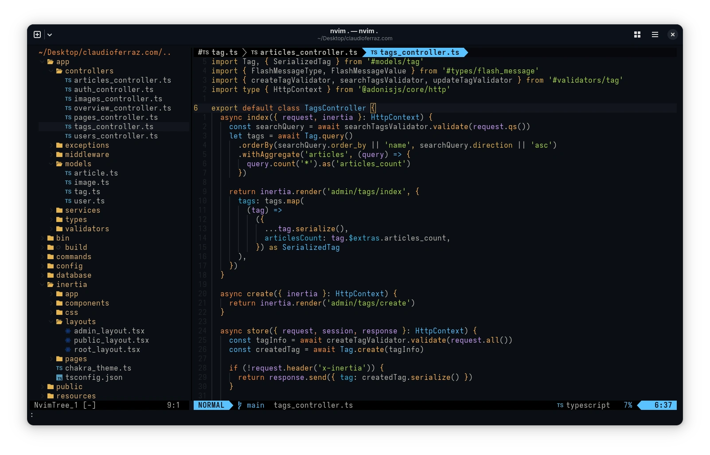

<div align="center">
<h1>My Dotfiles</h1>
<p>
  My configs and instructions for quickly setting up my preferred work environment on a new machine.
  <br/>I use this on my home-server, workstation, and laptop, all running Arch-based distros.
</p>

</div>

## Instructions - Step by step

The following instructions will help you set-up your environment from installing the required packages to correctly applying their saved configuration.

### Step 1 - Install dependencies

Install **Git** and **Curl**, which are required to run most of the other commands you'll see on this guide. To do so, run

```bash
sudo pacman -S git curl
```

### Step 2 - Clone the repo

Run the command to clone the repo and download the files to your machine

```bash
git clone https://github.com/claudiogferraz/.dotfiles ~/.dotfiles
```

### Step 3 - Install packages

We need to ensure that everything is installed before linking the configuration files.

The following packages will be installed at this step:

- Brush - POSIX compliant shell with lots of improvements over bash
- Mise - One tool for managing all your runtime versions
- Podman & Compose - Daemonless container management tool
- Vim - Without any plugins or custom config, just to quickly edit files when needed

First we Install all the software pre-packaged by your distro:

```bash
# Install Brush, Vim, Mise, Podman and Compose
sudo pacman -S brush gvim mise podman podman-compose
```

### Step 4 - Create symbolic links

```bash
# Link Git config
ln -sf ~/.dotfiles/.gitconfig ~/.gitconfig
```

```bash
# Link Bash config
ln -sf ~/.dotfiles/.bashrc ~/.bashrc
```

```bash
# Create .config dir if it doesn't exist
mkdir ~/.config
```

```bash
# Link Zed config
ln -sf ~/.dotfiles/.config/zed ~/.config/zed
```
